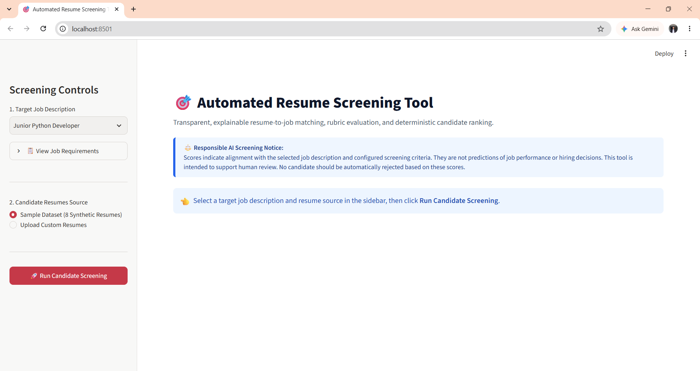
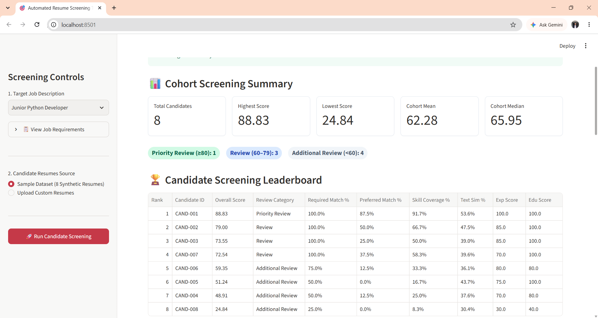
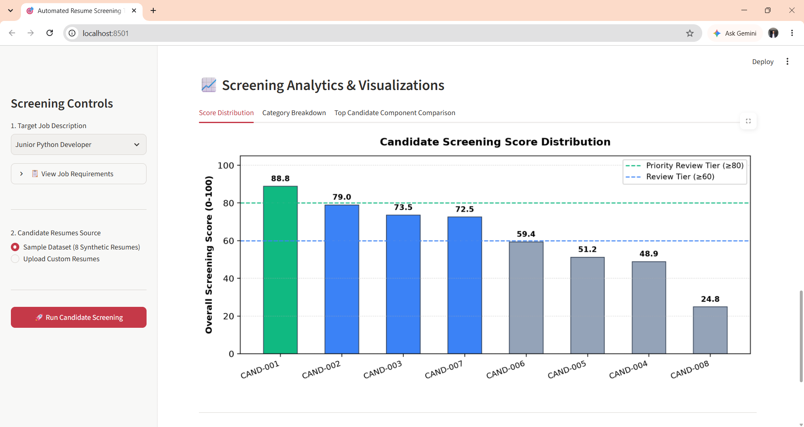
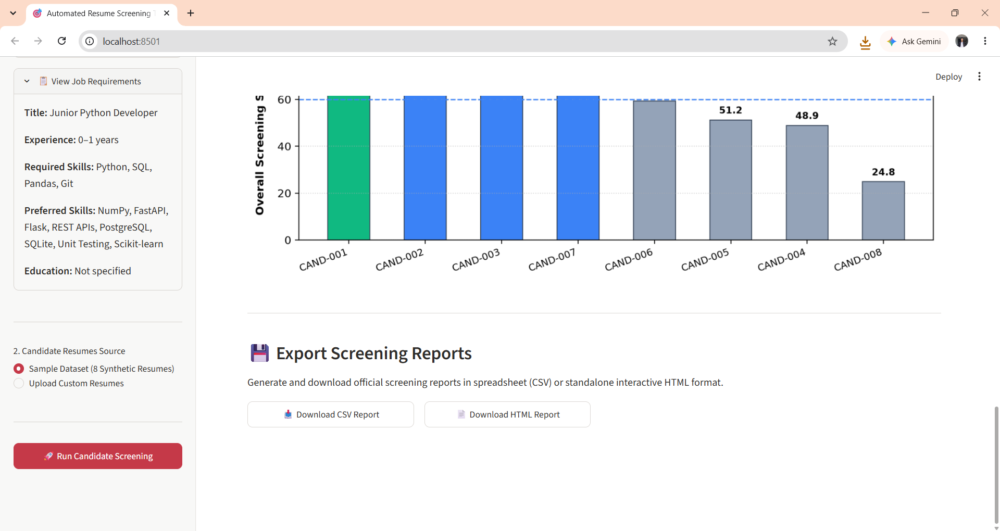

# Automated Resume Screening Tool

A modular, explainable, natural language processing resume screening and candidate evaluation platform developed in Python. Designed as a human-in-the-loop decision-support system, this platform parses multi-format candidate resumes, normalizes technical terminology, performs semantic TF-IDF text similarity analysis, computes multi-criteria rubric scores, ranks applicants deterministically, and presents visual audits via an interactive Streamlit dashboard.

---

## Executive Summary

### Business Problem
Technical recruitment teams routinely process hundreds of candidate applications for engineering positions. Manual screening across inconsistent document formats (PDF, DOCX, TXT) is labor-intensive, error-prone, and susceptible to unconscious bias. Conversely, proprietary automated hiring algorithms often operate as opaque black boxes that reject qualified applicants without justification.

### Proposed Solution
The Automated Resume Screening Tool provides an objective, explainable, and non-exclusionary triage workflow. Rather than making automated hiring or rejection decisions, the tool provides decision support for human recruiters:
- Parses candidate documents with automated format detection and error isolation.
- Normalizes technical skills and compound aliases (for example, Postgres to PostgreSQL, scikit-learn, C++, Node.js).
- Calculates lexical TF-IDF cosine similarity against target job requirements.
- Evaluates candidates against a transparent five-component scoring rubric totaling 100 percent.
- Ranks candidates using standard competition ranking (1, 1, 3 ranking) with deterministic tie-breaking rules.
- Exports audit-ready CSV reports (Excel-compatible) and standalone responsive HTML dossiers.
- Provides an interactive Streamlit web dashboard for real-time candidate evaluation and analytics.

---

## Core Features

- Multi-Format Resume Parsing: Robust text extraction from PDF (pdfplumber), DOCX (python-docx), and plain text files with automatic Latin-1 encoding fallback.
- Domain-Aware Text Normalization: Cleans and standardizes resume text while preserving critical programming language tokens (such as C++, C#, .NET, CI/CD, Node.js, and version decimals).
- Standardized Skill Taxonomy: Recognizes over 40 technical competencies across programming languages, web frameworks, database engines, and cloud tools with automated alias mapping.
- Structured Job Specification Modeling: Ingests plain text job descriptions and validated JSON requirement schemas to formulate standardized target profiles.
- TF-IDF Vector Similarity: Leverages Scikit-learn to compute term-frequency inverse-document-frequency vectors and cosine similarity against job descriptions.
- Transparent Weighted Scoring Rubric: Linearly synthesizes five evaluation pillars (Required Skills 35%, Preferred Skills 15%, Experience 20%, Text Similarity 20%, Education 10%).
- Deterministic Competition Ranking: Resolves score ties reproducibly using a five-level hierarchical tie-breaking protocol.
- Exportable Audit Reports: Generates spreadsheet-friendly CSV exports (UTF-8 with BOM) and self-contained HTML dossiers with complete point breakdowns.
- Interactive Web Dashboard: Modern Streamlit frontend offering dynamic job discovery, multi-file resume uploading, candidate leaderboards, and detailed profile audits.
- Responsible AI Governance: Adheres to ethical guidelines by providing neutral baseline scores for ambiguous sections, avoiding demographic inputs, and requiring human review.

---

## System Architecture

The following dataflow illustrates the sequential processing pipeline across decoupled modules:

```text
[Resume Files: PDF, DOCX, TXT]
              |
              v
[src/resume_parser.py] ---------> Document text extraction with encoding fallback
              |
              v
[src/text_cleaner.py] ----------> Token protection (C++, .NET, CI/CD) and whitespace cleanup
              |
              v
[src/skill_extractor.py] -------> Taxonomy lookup and alias normalization (skills.json)
              |
              +---------------------------+
              |                           |
              v                           v
     [Skill Coverage %]          [TF-IDF Cosine Similarity %]
              |                           |
              +-------------+-------------+
                            |
                            v
[src/matcher.py] ---------------> Resume-to-job matching engine
                            |
                            v
[src/score_calculator.py] ------> 5-component weighted rubric evaluation
                            |     (Req 35%, Pref 15%, Exp 20%, Sim 20%, Edu 10%)
                            v
[src/ranking.py] ---------------> Deterministic competition ranking (1, 1, 3)
                            |
              +-------------+-------------+
              |                           |
              v                           v
[src/report_generator.py]         [main.py: Streamlit Dashboard]
  - outputs/report.csv              - Summary Metric Cards
  - outputs/report.html             - Candidate Leaderboard
                                    - Interactive Profile Audit
                                    - Analytics Charts
```

---

## Technology Stack

- Programming Language: Python 3.11.9 or higher
- Data Analysis and Numerical Operations: Pandas 3.1.1, NumPy 2.4.6
- Document Parsing: pdfplumber 0.11.11, python-docx 1.2.0
- Machine Learning and NLP: Scikit-learn 1.9.1 (TfidfVectorizer, cosine_similarity)
- Web Interface: Streamlit 1.67.0
- Data Visualization: Matplotlib 3.11.2
- Test Framework: Python Standard Library unittest (158 automated tests)

---

## Project Directory Structure

```text
Automated-Resume-Screening-Tool/
|-- data/
|   |-- job_descriptions/
|   |   |-- junior_python_developer.txt               # Plain text job description
|   |   |-- junior_python_developer_requirements.json # Structured requirements schema
|   |   `-- .gitkeep
|   `-- skills_database/
|       |-- skills.json                               # Technical skill taxonomy and alias maps
|       `-- .gitkeep
|-- docs/
|   `-- .gitkeep                                      # Architecture notes and documentation
|-- images/
|   |-- README.md                                     # Screenshot specifications and capture instructions
|   |-- dashboard_overview.png                        # Main leaderboard and summary cards
|   |-- candidate_audit.png                           # In-depth candidate evaluation audit
|   |-- analytics_charts.png                          # Score distribution and category charts
|   |-- report_exports.png                            # Report download interface
|   `-- .gitkeep
|-- outputs/
|   |-- candidate_ranking_report.csv                  # Exported CSV candidate ranking
|   |-- candidate_ranking_report.html                 # Exported HTML candidate report
|   `-- .gitkeep
|-- resumes/
|   `-- sample_resumes/
|       |-- CAND-001.txt                              # Synthetic candidate profile 1
|       |-- CAND-002.txt                              # Synthetic candidate profile 2
|       |-- CAND-003.txt                              # Synthetic candidate profile 3
|       |-- CAND-004.txt                              # Synthetic candidate profile 4
|       |-- CAND-005.txt                              # Synthetic candidate profile 5
|       |-- CAND-006.txt                              # Synthetic candidate profile 6
|       |-- CAND-007.txt                              # Synthetic candidate profile 7
|       |-- CAND-008.txt                              # Synthetic candidate profile 8
|       |-- DATASET_README.md                         # Synthetic resume dataset specification
|       `-- .gitkeep
|-- src/
|   |-- __init__.py                                   # Package initialization
|   |-- resume_parser.py                              # Text extraction from PDF, DOCX, TXT
|   |-- text_cleaner.py                               # Regex-based text normalization
|   |-- skill_extractor.py                            # Taxonomy-based skill matching
|   |-- job_parser.py                                 # Job requirement schema validation
|   |-- matcher.py                                    # TF-IDF similarity and skill match metrics
|   |-- score_calculator.py                           # Multi-criteria weighted scoring engine
|   |-- ranking.py                                    # Deterministic candidate ranking
|   `-- report_generator.py                           # CSV and HTML report generation
|-- tests/
|   |-- test_resume_parser.py                         # Parser unit tests (13 tests)
|   |-- test_text_cleaner.py                          # Cleaner unit tests (21 tests)
|   |-- test_skill_extractor.py                       # Extractor unit tests (23 tests)
|   |-- test_job_parser.py                            # Job parser unit tests (20 tests)
|   |-- test_matching.py                              # Matching engine tests (21 tests)
|   |-- test_score_calculator.py                      # Scoring logic tests (17 tests)
|   |-- test_ranking.py                               # Ranking and tie-breaker tests (20 tests)
|   |-- test_report_generator.py                      # Report export tests (16 tests)
|   `-- test_dashboard.py                             # UI integration and safety tests (7 tests)
|-- .env.example                                      # Environment variable template
|-- .gitignore                                        # Comprehensive git exclusion configuration
|-- main.py                                           # Streamlit dashboard application entry point
|-- README.md                                         # Primary project documentation
|-- requirements.txt                                  # Pinned dependency requirements
`-- run_project.bat                                   # Windows quick-launch script
```

---

## Installation and Setup

### Prerequisites
- Python 3.11 or higher
- Git

### Step 1: Clone the Repository
```bash
git clone https://github.com/your-username/Automated-Resume-Screening-Tool.git
cd Automated-Resume-Screening-Tool
```

### Step 2: Create a Virtual Environment

On Windows (PowerShell):
```powershell
python -m venv .venv
.\.venv\Scripts\Activate.ps1
```

On macOS or Linux (Bash):
```bash
python3 -m venv .venv
source .venv/bin/activate
```

### Step 3: Install Required Dependencies
```bash
pip install -r requirements.txt
```

---

## Running the Application

### Option 1: Streamlit Command Line
With the virtual environment activated, run:
```bash
streamlit run main.py
```
The dashboard will open automatically in your browser at `http://localhost:8501`.

### Option 2: Windows Quick-Launch Script
On Windows, you can double-click `run_project.bat` or execute it from PowerShell:
```cmd
run_project.bat
```

### How to Use the Dashboard
1. Select Target Job: Choose a target job description in the sidebar (for example, Junior Python Developer).
2. Inspect Requirements: Expand the requirements dropdown to view mandatory and preferred skills.
3. Choose Resume Source: Select between the built-in 8 synthetic resumes or upload custom PDF, DOCX, or TXT documents.
4. Run Screening: Click the primary Run Candidate Screening button.
5. Review Results: Examine cohort metrics, leaderboard rankings, and analytics charts.
6. Audit Candidates: Select individual candidates to inspect exact point contributions and skill gaps.
7. Download Reports: Click Download CSV Report or Download HTML Report to save official evaluation files.

---

## Running the Test Suite

The test suite contains 158 automated unit and integration tests with 100 percent pass rates across all modules.

To execute the entire test suite using Python discovery:
```bash
python -m unittest discover -s tests -p "test_*.py" -v
```

To run individual test modules:
```bash
python -m unittest tests.test_dashboard -v
python -m unittest tests.test_report_generator -v
python -m unittest tests.test_ranking -v
python -m unittest tests.test_score_calculator -v
python -m unittest tests.test_matching -v
python -m unittest tests.test_job_parser -v
python -m unittest tests.test_skill_extractor -v
python -m unittest tests.test_text_cleaner -v
python -m unittest tests.test_resume_parser -v
```

---

## Synthetic Dataset

The repository includes eight realistic synthetic candidate resumes stored in `resumes/sample_resumes/`. These profiles represent diverse qualification levels for an entry-level Junior Python Developer role.

| Candidate ID | Profile Archetype | Key Technical Qualifications | Review Category | Overall Score |
| :--- | :--- | :--- | :--- | :---: |
| CAND-001 | Strong Python Developer | Full core skills, 7 of 8 preferred skills, 1-year internship, B.S. CS | Priority Review | 88.83 |
| CAND-002 | Python Backend Developer | Full core skills, Flask, REST APIs, PostgreSQL, 6-month internship, B.S. CS | Review | 79.00 |
| CAND-003 | Data / ML Candidate | Full core skills, NumPy, Scikit-learn, 6-month internship, B.S. CS | Review | 73.55 |
| CAND-007 | CS Academic Graduate | Full core skills, TA and capstone experience, B.S. CS | Review | 72.54 |
| CAND-006 | Career Transitioner (Analyst) | 3 of 4 core skills, 1 year data analyst experience, Associate Degree Web Dev | Additional Review | 59.35 |
| CAND-005 | Junior Developer (Basic) | 2 of 4 core skills, 3-month summer internship, B.S. CS | Additional Review | 51.24 |
| CAND-004 | Frontend / Web Developer | 2 of 4 core skills, web apprenticeship, Associate Degree Web Dev | Additional Review | 48.91 |
| CAND-008 | Non-Technical Applicant | 1 of 4 core skills (Git), administrative tenure, B.A. Communications | Additional Review | 24.84 |

Comprehensive documentation regarding the synthetic dataset design and generation constraints is available in `resumes/sample_resumes/DATASET_README.md`.

---

## Scoring Methodology and Rubrics

The evaluation engine computes a transparent composite score on a scale from 0 to 100 points:

```text
Overall Score = (0.35 * Required_Match) + (0.15 * Preferred_Match) + (0.20 * Experience_Score) + (0.20 * Text_Similarity) + (0.10 * Education_Score)
```

### Component Weights
- Required Skills (35% weight): Ratio of mandatory skills present in candidate resume.
- Preferred Skills (15% weight): Ratio of bonus and preferred skills present in candidate resume.
- Experience Rubric (20% weight): Evaluates verifiable tenure against target requirements (0 to 1 years):
  - 100 points: Greater than or equal to 1 year professional experience or full-year software internship.
  - 85 points: 6 to 11 months software engineering internship.
  - 75 points: 3 to 5 months software engineering internship.
  - 70 points: Formal coding apprenticeship, academic TA, or capstone practical training.
  - 50 points: Personal projects, academic coursework, or self-taught coding (neutral baseline).
  - 30 points: Non-technical employment history transitioning to software development.
- Text Similarity (20% weight): Scikit-learn TF-IDF vectorization and cosine similarity between cleaned resume and job description.
- Education Rubric (10% weight):
  - 100 points: B.S. or M.S. in Computer Science, Software Engineering, or Data Science.
  - 80 points: Associate Degree in Web Development/IT or B.B.A. in Information Systems.
  - 75 points: Quantitative STEM discipline (Mathematics, Physics, Electrical Engineering).
  - 40 points: Non-technical degree (coding evaluated through practical projects).
  - 50 points: Alternative or unspecified educational background (non-exclusionary baseline).

### Review Categories
Candidates are organized into actionable review tiers:
- Priority Review (score 80.00 to 100.00): Strong technical alignment across core requirements, tenure, and education.
- Review (score 60.00 to 79.99): Solid qualifications with minor gaps in secondary tooling.
- Additional Review (score 0.00 to 59.99): Non-traditional backgrounds or emerging skill sets requiring holistic recruiter assessment.

### Deterministic Tie-Breaking Order
If two or more candidates achieve identical overall scores, display order is determined hierarchically:
1. Overall Screening Score (descending)
2. Required Skill Match Percentage (descending)
3. Overall Skill Coverage Percentage (descending)
4. Text Similarity Percentage (descending)
5. Candidate ID (ascending lexicographical comparison)

---

## Dashboard Screenshots

The visual assets below represent key views of the interactive screening dashboard. Placeholders link directly to screenshots stored in the `images/` directory.

### 1. Leaderboard and Cohort Overview
The primary dashboard interface displaying summary metrics cards, review category distribution pills, and the ranked candidate leaderboard.



### 2. Candidate Evaluation and Audit View
Detailed profile inspection displaying weighted component point contributions, matched required skills, and missing capabilities.



### 3. Analytics and Visual Distributions
Comparative visualization tab displaying candidate score distributions with review tier thresholds, alongside component comparisons.



### 4. Official Report Export Interface
One-click generation of spreadsheet-ready CSV files and self-contained interactive HTML dossiers.



---

## Responsible AI and Governance

The Automated Resume Screening Tool is engineered in compliance with non-exclusionary algorithmic screening principles:
- Decision Support Only: Ranking and scoring functions serve solely to prioritize recruiter workflow queues. The tool never makes automated hiring or rejection decisions.
- Non-Predictive Metrics: Scores indicate lexical and rubric alignment with published requirements; they do not predict workplace performance, work ethic, or cultural collaboration.
- Exclusion of Demographic Attributes: Candidate race, gender, age, nationality, marital status, and religion are completely omitted from data models and scoring algorithms.
- Non-Exclusionary Baselines: Missing or ambiguous education and experience sections default to neutral baseline scores (50 out of 100 points) rather than zero.
- Synthetic Training Data: The default candidate dataset is fully synthetic, eliminating concerns regarding personal identifiable information (PII).

---

## Limitations

Users and technical reviewers should note the following system boundaries:
- Digital Text Requirement: Documents must contain extractable text. Scanned bitmap images without OCR text layers are not supported.
- Lexical Keyword Dependency: Skill identification relies on structured taxonomies and alias lists. Unrecognized phrasing or novel acronyms may not be detected.
- Lexical Text Similarity: TF-IDF evaluates word-frequency alignment rather than deep contextual semantic reasoning.
- Rule-Based Extraction: Experience duration and degree fields are parsed using deterministic regular expressions.
- Local Architecture: The system runs locally as an in-memory utility without persistent database storage or multi-user authentication.

---

## Future Improvements

Recommended architectural extensions for future iterations:
- Optical Character Recognition: Integrate OCR libraries (such as pytesseract) for scanned document parsing.
- Transformer Semantic Embeddings: Implement Sentence-Transformers (for example, all-MiniLM-L6-v2) to capture deep conceptual resume-to-job similarity.
- Persistent Relational Database: Add PostgreSQL or SQLite database integration with SQLAlchemy ORM for permanent applicant storage.
- User Authentication: Implement role-based access control (RBAC) for recruitment teams and hiring managers.
- Cloud Deployment: Package the application into Docker containers for deployment on cloud platforms (AWS, GCP, or Azure).
- Algorithmic Fairness Auditing: Implement disparate impact analysis tooling to evaluate ranking distributions across demographic cohorts.

---

## License

This project is licensed under the MIT License. See the LICENSE file for details.
